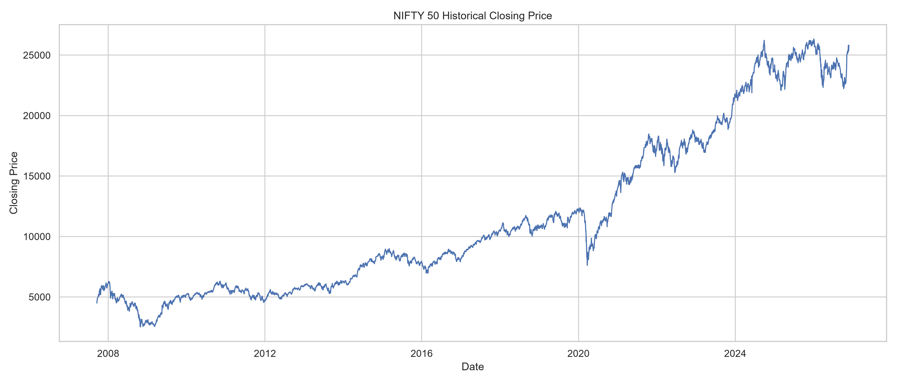
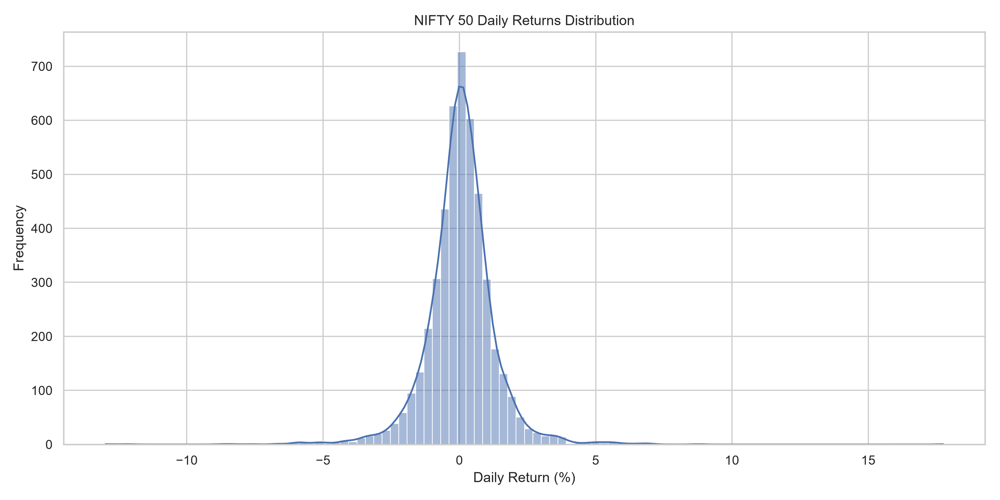
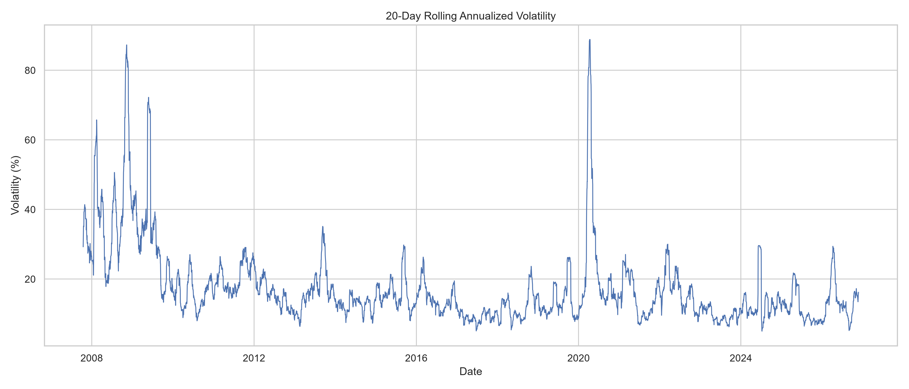
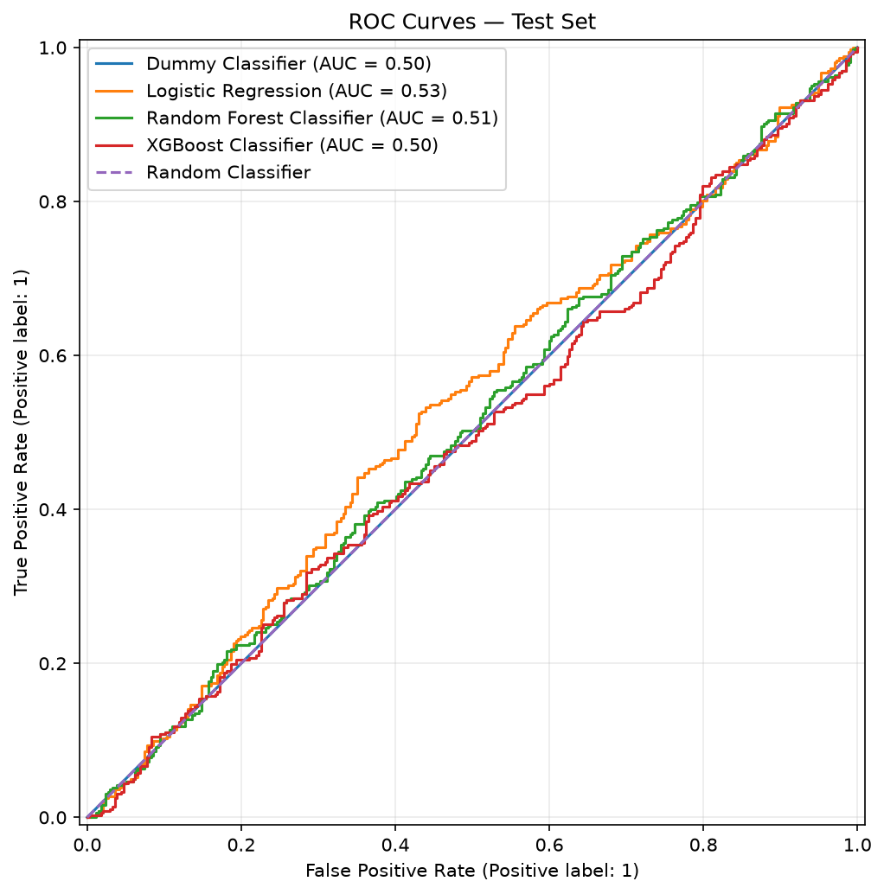
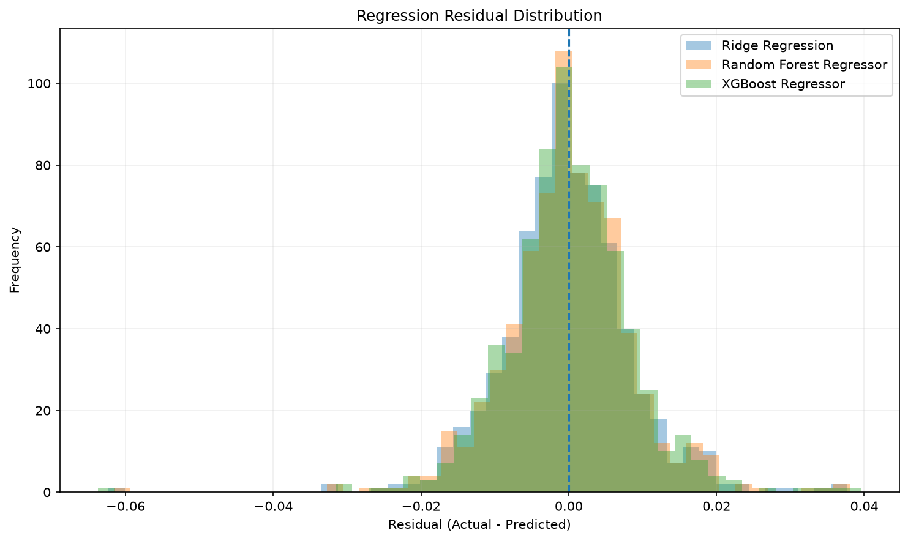
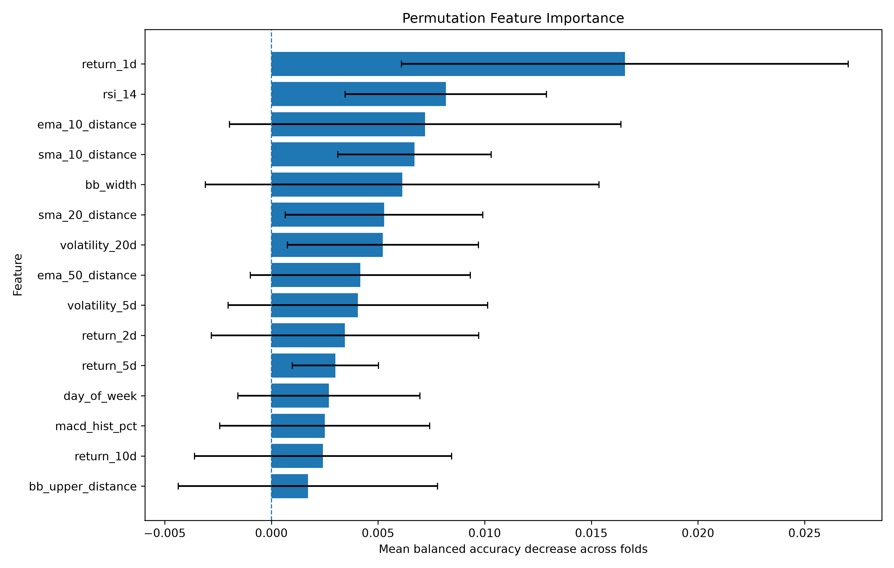
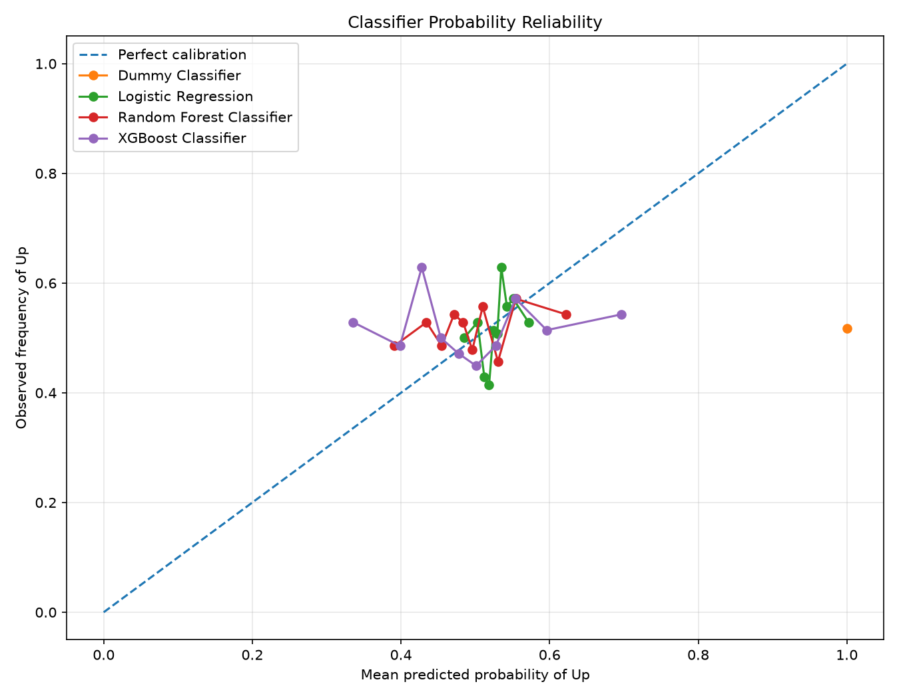

# 📈 StockSense AI

## Experimental NIFTY 50 Forecasting & Analytics Platform

StockSense AI is an end-to-end machine learning project for exploring
next-session NIFTY 50 market direction and return forecasting.

It combines historical market-data ingestion, data validation, technical
feature engineering, machine learning models, time-based evaluation, a FastAPI
inference backend, and an interactive Streamlit dashboard.

> **Research disclaimer:** This is an experimental educational project. The
> models have not demonstrated reliable predictive performance on the held-out
> test period. Predictions are not investment advice, trading signals, or
> guarantees of future market performance.

---

## Project Overview

StockSense AI addresses two experimental forecasting tasks:

- **Classification:** Predict whether the next trading session's return will be
  positive or non-positive.
- **Regression:** Estimate the next trading session's percentage return.

The project emphasizes the complete ML engineering workflow, including data
quality checks, leakage-aware feature engineering, baseline comparisons,
held-out testing, error analysis, API development, and dashboard integration.

## Architecture

```text
Yahoo Finance
     |
     v
Data Ingestion (yfinance)
     |
     v
Data Validation
     |
     v
Historical Market Data
     |
     v
Feature Engineering
(24 Technical & Calendar Features)
     |
     v
Time-Based Data Splitting
     |
     v
Model Training & Evaluation
     |
     +----------------------+
     |                      |
     v                      v
Classification Models   Regression Models
     |                      |
     +----------+-----------+
                |
                v
        Model Artifacts
                |
                v
       FastAPI Inference API
                |
                v
       Streamlit Dashboard
```

## Technology Stack

| Area | Technologies |
| --- | --- |
| Language | Python |
| Data processing | Pandas, NumPy |
| Market data | yfinance |
| Technical indicators | ta |
| Machine learning | Scikit-learn, XGBoost |
| Model serialization | Joblib |
| Backend | FastAPI, Uvicorn |
| Frontend | Streamlit |
| Visualization | Plotly, Matplotlib, Seaborn |
| Testing | Pytest |

## Features

### 1. Market Data Pipeline

- Downloads historical NIFTY 50 index data using Yahoo Finance ticker `^NSEI`.
- Uses daily historical OHLCV data.
- Normalizes trading dates to the Asia/Kolkata timezone.
- Checks missing values, duplicate dates, invalid prices, OHLC relationships,
  and negative volume.
- Saves the validated dataset locally.

### 2. Feature Engineering

Generates 24 features from historical market data.

| Feature group | Features |
| --- | --- |
| Historical returns | 1-day, 2-day, 3-day, 5-day, 10-day returns |
| Moving averages | SMA and EMA distances for 10, 20, and 50 sessions |
| Momentum | RSI (14), MACD, MACD signal, MACD histogram |
| Volatility | ATR (14), Bollinger Band distances and width |
| Rolling volatility | 5-day, 10-day, and 20-day volatility |
| Calendar | Day of week and month |

The prediction target is calculated using the next available trading session's
close relative to the current session's close.

Feature engineering uses historical information available at the prediction
point. Tests include checks intended to detect future-data leakage.

### 3. Machine Learning Models

#### Classification Models

- Dummy Classifier
- Logistic Regression
- Random Forest Classifier
- XGBoost Classifier

#### Regression Models

- Zero Return Baseline
- Ridge Regression
- Random Forest Regressor
- XGBoost Regressor

### 4. Evaluation and Diagnostics

The project includes:

- Validation-based model comparison
- Final held-out test evaluation
- Walk-forward evaluation
- Classification threshold analysis
- Confusion matrices
- ROC and precision-recall curves
- Probability diagnostics
- Regression residual analysis
- Feature importance analysis
- Market regime analysis

Validation results and final held-out test results are treated separately.

## Held-Out Test Results

The following results are from the final held-out evaluation.

### Classification

| Model | Accuracy | Balanced Accuracy | F1 | ROC-AUC |
| --- | ---: | ---: | ---: | ---: |
| Dummy Classifier | 51.79% | 50.00% | 0.6824 | 0.5000 |
| Logistic Regression | 50.79% | 49.44% | 0.6468 | 0.5320 |
| Random Forest | 50.64% | 50.94% | 0.4717 | 0.5107 |
| XGBoost | 49.93% | 50.08% | 0.4868 | 0.4953 |

### Regression

| Model | MAE | RMSE | R² | Directional Accuracy |
| --- | ---: | ---: | ---: | ---: |
| Zero Return Baseline | 0.006201 | 0.008626 | -0.0013 | — |
| Ridge Regression | 0.006298 | 0.008711 | -0.0213 | 49.50% |
| Random Forest | 0.006202 | 0.008638 | -0.0042 | 51.22% |
| XGBoost | 0.006224 | 0.008636 | -0.0038 | 52.22% |

*MAE and RMSE are expressed in decimal-return units, not percentage points.*

### What the results tell us

- Classification ROC-AUC scores are close to 0.5, indicating weak ability to
  distinguish positive from non-positive returns.
- The dummy classifier achieves higher accuracy than the trained classifiers.
- All regression models have negative R² on the final test set.
- None of the regression models beats the zero-return baseline on MAE or RMSE.
- XGBoost achieves the highest directional accuracy among the regression
  models, but this does not establish a reliable predictive edge.

**The evaluation does not support using these models for real-world trading
decisions.** The project is primarily an exploration of the end-to-end machine
learning workflow and its engineering components.

## Interactive Dashboard

The Streamlit dashboard provides:

- API and model health status
- Latest available market close and data date
- Classification predictions and model probabilities
- Model agreement summary
- Regression forecasts
- Interactive Plotly charts
- Latest technical feature values
- Model information

The dashboard explicitly distinguishes model agreement from prediction accuracy.

It uses a local historical CSV dataset. The latest available date in that file
is not necessarily today's market date, and the dashboard is not a live
market-data feed.

## REST API

The FastAPI backend exposes the following endpoints:

| Method | Endpoint | Description |
| --- | --- | --- |
| GET | `/` | API welcome message |
| GET | `/health` | API and model availability |
| GET | `/features/latest` | Latest available feature values |
| GET | `/predict/latest` | Experimental next-session predictions |
| GET | `/model-info` | Model metadata |

Interactive API documentation is available at `/docs` when the backend is running.

## Getting Started

### Prerequisites

- Python 3.14 (the development environment used for this project)
- Git
- PowerShell or another terminal

### 1. Clone the repository

```powershell
git clone https://github.com/nitin28061999/StockSense-AI.git
cd StockSense-AI
```


### 2. Create and activate a virtual environment

```powershell
python -m venv .venv
.\.venv\Scripts\Activate.ps1
```

### 3. Install dependencies

```powershell
python -m pip install --upgrade pip
pip install -r requirements.txt
```

### 4. Download historical market data

```powershell
python -m src.data.ingest
```

This creates the local raw market-data CSV.

### 5. Build technical features

```powershell
python -m src.features.build_features
```

### 6. Start the FastAPI backend

```powershell
python -m uvicorn src.api.main:app --host 127.0.0.1 --port 8000
```

API base URL:

```text
http://127.0.0.1:8000
```

API documentation:

```text
http://127.0.0.1:8000/docs
```

### 7. Start the Streamlit dashboard

Open a second terminal, activate the same virtual environment, and run:

```powershell
python -m streamlit run dashboard/app.py
```

Dashboard URL:

```text
http://localhost:8501
```

To use a different backend URL, set the environment variable
`STOCKSENSE_API_URL` before starting Streamlit.

> **Note:** The repository's inference API expects compatible trained model
> artifacts and processed historical data. The README setup steps download and
> engineer data; they do not by themselves retrain the models.

## Running Tests

Run the complete test suite:

```powershell
python -m pytest -v
```

The current test suite contains 23 tests covering:

- API endpoints and error handling
- Data validation
- Feature engineering
- Target construction
- Future-data leakage checks
- Inference input validation
- Prediction output structure

Latest verified result in the development environment: **23 passed**.

These tests validate software behavior, not the predictive accuracy of the models.

## Project Structure

```text
StockSense-AI/
│
├── artifacts/
│   ├── baselines/
│   └── tree_models/
│
├── dashboard/
│   └── app.py
│
├── data/
│   ├── raw/                 # Downloaded local market data
│   └── processed/           # Generated features and data splits
│
├── reports/
│   ├── eda/
│   ├── error_analysis/
│   ├── feature_importance/
│   ├── models/
│   └── probability_diagnostics/
│
├── src/
│   ├── api/
│   ├── data/
│   ├── evaluation/
│   ├── features/
│   ├── inference/
│   └── models/
│
├── tests/
│   ├── test_api.py
│   ├── test_data_validation.py
│   ├── test_feature_engineering.py
│   └── test_inference.py
│
├── .gitignore
├── requirements.txt
└── README.md
```

## Selected Evaluation Visualizations

### Exploratory Data Analysis







### Model Diagnostics









## Limitations and Future Improvements

- Improve model generalization and predictive performance.
- Investigate additional market features and alternative target definitions.
- Evaluate robustness across different market regimes.
- Explore improved probability calibration.
- Expand walk-forward and stress-testing procedures.
- Add automated data-refresh and model-monitoring workflows.
- Explore reproducible experiment tracking and deployment automation.

Any future improvements should be validated on data not used for model selection.

## Disclaimer

StockSense AI is an experimental machine learning and educational project.
Historical market data and model predictions may be incomplete, inaccurate, or
outdated. No model output should be interpreted as financial advice, a
recommendation to buy or sell securities, or a guarantee of future returns.

Market data is retrieved through Yahoo Finance using `yfinance`. Users should
review the applicable data-provider terms before using or redistributing
downloaded data.

---

**Built as an end-to-end machine learning engineering portfolio project.**
